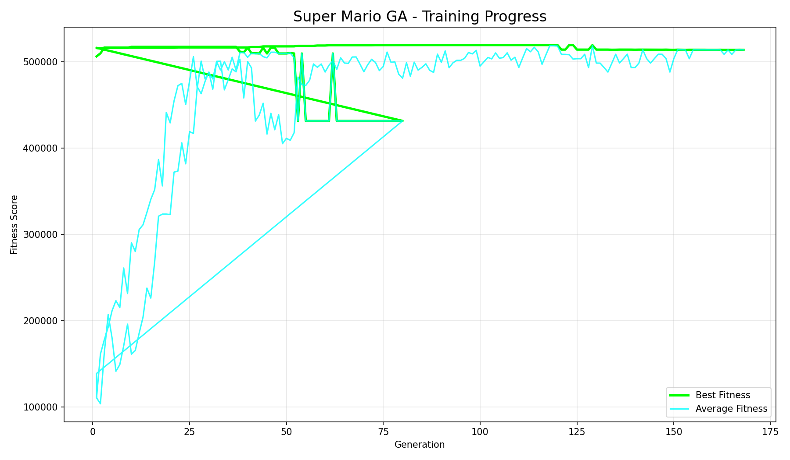

# Super Mario GA AI — Neuroevolution Project

A neuro-evolutionary AI that learns to play a Mario-style platformer built with Pygame. I used a **Genetic Algorithm + Neural Network** setup: each agent's brain is a feed-forward neural network, and the GA evolves the network weights generation by generation — from random movement toward a completionist player that collects coins, avoids enemies, and reaches the goal.



*(Plot generated from the real `training_log.csv` — best and average fitness per generation.)*

## Features

- **Neural Network brain** — 16 sensory inputs, 2 hidden layers (48 → 32, ReLU), 4 action outputs (left / right / jump / no-op via argmax)
- **Genetic Algorithm** — population of 100, tournament selection, blend crossover, elitism (top 12 survive unchanged), adaptive Gaussian mutation with decaying rate
- **Completionist fitness** — heavily rewards coin collection, goal progress, goal completion bonus; penalizes deaths, being stuck, and slow progress
- **Multi-level curriculum** — 3 hand-designed levels; the population advances to the next level once the best fitness crosses 13,500
- **God View training** — all 100 agents simulated in parallel and rendered together
- **Scientific logging** — `training_log.csv` (per-generation best/avg fitness) and `agent_state_log.csv` (sensory inputs → network outputs → chosen action)
- **Early stopping & model snapshotting** — stops after 70 generations without improvement (past generation 40); best genomes saved as `.pkl` in `saved_models/`

## Results (verifiable in `training_log.csv`)

- **Peak best fitness: ~519,000** across the logged generations
- Trained through all 3 curriculum levels (log shows training active on Level 3)
- `saved_models/` contains the evolved best genomes, including `final_best_genome.pkl`
- Note: this is a Mario-*style* platformer built from scratch with Pygame — it is not the Nintendo game

## Tech Stack

- Python
- Pygame (game engine)
- NumPy (neural network)
- Matplotlib (training plots)

## Project Structure

```bash
Super-Mario-Ga-Ai/
├── main.py               # menu: 1 = play as human, 2 = AI training
├── src/
│   ├── game.py           # game engine + 3 levels + AI sensor system
│   ├── trainer.py        # training loop + fitness function
│   ├── ga.py             # genetic algorithm (selection/crossover/mutation)
│   ├── neural_network.py # 16-48-32-4 feed-forward network
│   ├── player.py         # player physics/scoring
│   ├── enemy.py          # enemy behavior
│   ├── level.py          # level parsing + asset loading
│   ├── physics.py        # shared physics helpers
│   ├── menu.py           # main menu
│   └── utils.py          # genome save/load + CSV logging
├── assets/               # sprites (player, enemy, coin, tile, goal, background)
├── saved_models/         # evolved best genomes (.pkl)
├── training_log.csv      # per-generation stats from my training run
├── agent_state_log.csv   # sensory input/output logs from my training run
├── Figure_2.png          # training-progress plot (generated from training_log.csv)
├── requirements.txt
├── LICENSE
└── README.md
```

## How to Run

```bash
pip install -r requirements.txt
python main.py
```

Then:
- Press **1** → Play as Human (arrow keys / space to jump)
- Press **2** → Start AI Training (evolves 100 agents; watch the God View)
- Press **3** → Exit

> Training appends to `training_log.csv` and `agent_state_log.csv` and saves the best genome to `saved_models/` as it improves.

## License

This project is open source and available under the [MIT License](LICENSE).

## Author

**Kifayat Irfan**
